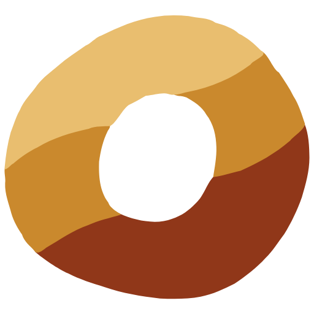

<h1 align="center">Ochre</h1>

 

<em>ochre: an earth pigment, among the oldest colours people have used.</em>

Ochre is a task-first **agent development environment** (ADE) for Claude Code. It is a command center where the durable unit of work is the **task**, not the agent session. Sessions, worktrees, terminals, PRs and Jira issues attach to a task, come and go, and the task remembers where you got to.

> **Status:** M0 (stack spike) settled the stack: a .NET 10 host with the UI in WebView2 ([results](docs/spike-stack-results.md)). M1 (tasks and controlled sessions), M2 (park, resume, Today, and sessions started outside Ochre), M3 (terminal tabs) and M4 (modules: git and worktrees, sprig, multiple windows) are done, and M5 (attention inbox, notifications and the agent grid) is built with its hand checks open. Next: an installer, then M6 (editor); see [docs/roadmap.md](docs/roadmap.md) and [docs/implementation-plan.md](docs/implementation-plan.md).

## Why

Claude sessions end up being the to-do list, and that list disappears every time they restart. At the end of a day the agents reach a sensible stopping point, and the next morning there is no record of where to start. Ochre fixes that by making tasks outlive sessions, and by having agents leave a "state + next step" note when a task is parked.

## Principles

1. **Tasks first.** You start agents *from* a task; the task holds the plan, the links and the history.
2. **Compose, don't prescribe.** Every feature beyond the kernel is a module you can turn off. No sprig? No worktrees? No Jira? Everything else still works.
3. **Same contracts for us and for plugins.** First-party features are built as modules against the extension points third-party plugins use.
4. **Explicit over magic.** Detection suggests (bind this session to that task?); it never silently acts.
5. **Plain data.** Tasks are markdown files that agents and other tools can read.
6. **Pay startup once.** A background tray process keeps monitoring when no window is open.

## Documentation

| Doc | What it covers |
|---|---|
| [docs/vision.md](docs/vision.md) | Problem, requirements, non-goals |
| [docs/architecture.md](docs/architecture.md) | Process model, kernel, modules, extension points, UI stack |
| [docs/task-model.md](docs/task-model.md) | Task file format, lifecycle, links hub, agent CLI/MCP, session binding, park/resume |
| [docs/security.md](docs/security.md) | Threat model and required mitigations |
| [docs/roadmap.md](docs/roadmap.md) | Milestones M0 onwards with exit criteria |
| [docs/spike-stack.md](docs/spike-stack.md) | M0: the stack spike that settles the UI technology |
| [docs/spike-stack-results.md](docs/spike-stack-results.md) | M0 measurements and the shell decision |
| [docs/implementation-plan.md](docs/implementation-plan.md) | How M0 and M1 get built, slice by slice, and the testing stance |
| [docs/reuse-from-perch.md](docs/reuse-from-perch.md) | What to copy from Perch and where it lives |
| [docs/landscape.md](docs/landscape.md) | Other ADEs as of Nov 2026 and where Ochre differs |
| [docs/decisions/](docs/decisions/) | Architecture decision records |

## Getting started

Prerequisites (expected; confirmed by the spike):

- Windows 11 (macOS later), .NET 10 SDK
- Node.js LTS + pnpm (UI build), with install scripts disabled
- Claude Code installed and signed in
- WebView2 runtime (ships with Windows 11)

Start with [docs/roadmap.md](docs/roadmap.md), then the spike plan.

## Related tools

Ochre is designed to compose with, never require: **Perch** (tray watcher for Claude Code sessions, and the source of much reusable code), **sprig** (worktree slots with isolated ports and env), **Hypertree** (spatial compartmentalisation) and **flamingle** (terminal layouts).
